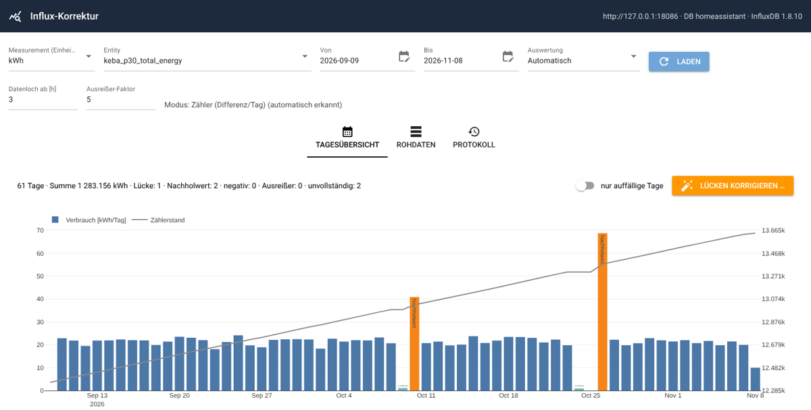
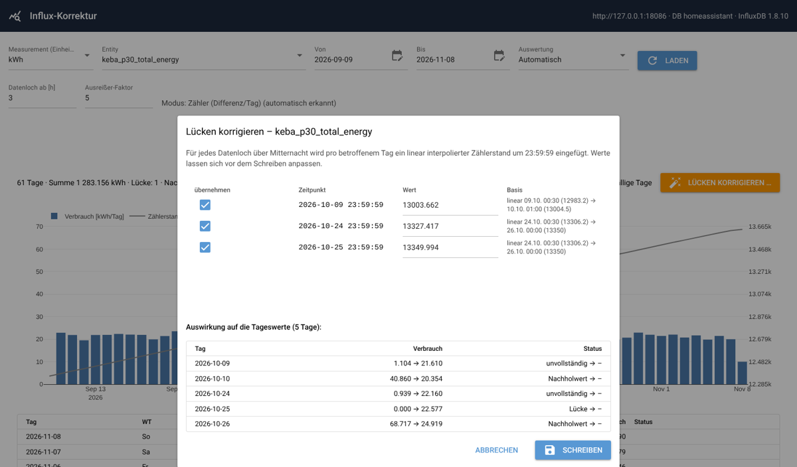
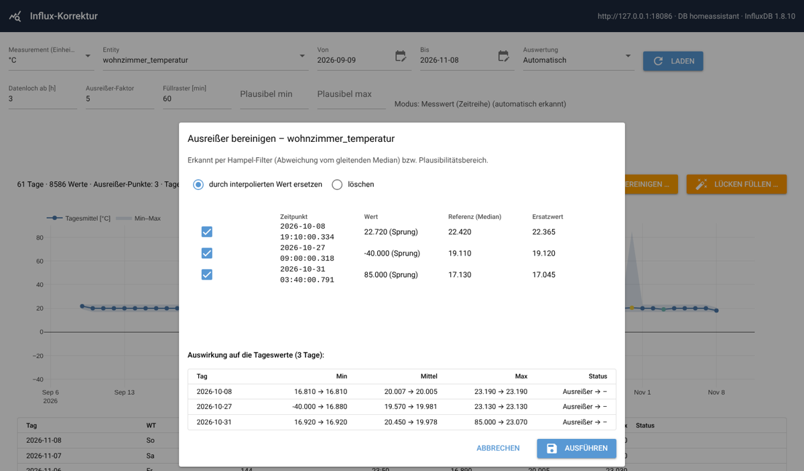
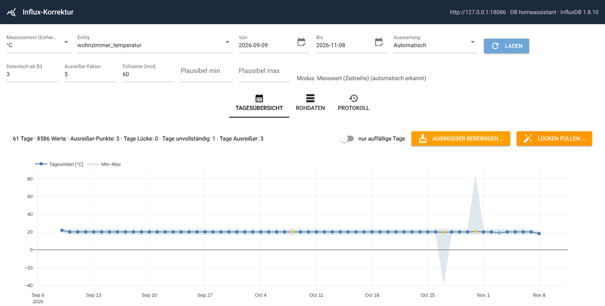
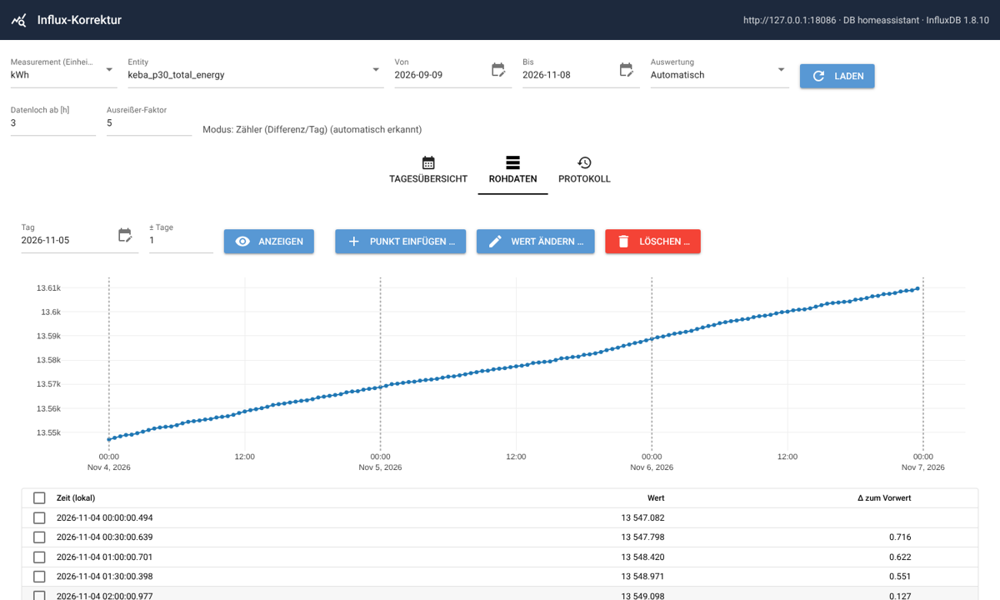

# Influx-Korrektur

[English](README.md) | **Deutsch**

Eine kleine Web-App zum **Kontrollieren und Korrigieren von Zeitreihen in InfluxDB**, die
[Home Assistant](https://www.home-assistant.io/) über die
[InfluxDB-Integration](https://www.home-assistant.io/integrations/influxdb/) schreibt.
Läuft als eigenständiger Docker-Container, z. B. auf einer Synology.



## Wozu?

Viele Auswertungen berechnen Tages- oder Monatsverbräuche aus dem **absoluten Zählerstand** (Strom, Wasser, Gas),
typischerweise mit einer Abfrage wie

```sql
SELECT derivative(max("value"), 1d) FROM "kWh"
WHERE "entity_id" = 'mein_zaehler' AND time >= now() - 400d
GROUP BY time(1d) fill(previous) tz('Europe/Berlin')
```

Liefert ein Sensor einen Tag lang keine Werte, steht an diesem Tag **0** und der **Folgetag bekommt den Verbrauch
beider Tage**. Abhilfe schaffen interpolierte Zwischenwerte. Bisher hieß das: API-Aufrufe von Hand mit von Hand
berechneten Zeitstempeln. Dieses Tool erledigt das mit wenigen Klicks, mit Vorschau der Auswirkung und vollständigem
Undo.

Für normale Messwerte (Temperatur, Feuchte, …) gilt das Gleiche: Lücken lassen sich füllen, Ausreißer
(Sensorfehler wie `85.0` oder `-40.0`) löschen oder ersetzen.

## Funktionen

- **Tagesübersicht** mit Diagramm und Statusmarken für jeden Tag
- **Zwei Auswertungsmodi**, pro Serie wählbar, standardmäßig automatisch erkannt:
  - **Zähler**: Tagesverbrauch = max(Tag) − max(Vortag), identisch zur Abfrage oben
  - **Messwert**: Tages-Min/-Mittel/-Max für normale Zeitreihen
- **Lücken korrigieren/füllen**: linear interpolierte Punkte, vor dem Schreiben änderbar
- **Ausreißer bereinigen** (Messwert-Modus): Hampel-Filter plus optionaler Plausibilitätsbereich; löschen oder
  durch interpolierten Wert ersetzen
- **Rohdaten**: einzelne Punkte einfügen, ändern oder löschen, mit Interpolation aus den Nachbarwerten
- **Vorschau** jeder Änderung: Tageswerte vorher → nachher
- **Protokoll mit Undo**: Vor jeder Änderung werden die Originalpunkte (alle Fields, exakte Tags) gesichert
- Unterstützt **InfluxDB 1.8** (z. B. das Home-Assistant-Add-on) und **InfluxDB 2.x** (automatische Erkennung)

## Screenshots

| Lückenkorrektur (Zähler) | Ausreißer bereinigen (Messwert) |
|---|---|
|  |  |

| Messwert-Übersicht (Min–Max-Band, Tagesmittel) | Rohdaten |
|---|---|
|  |  |

## Auswertungsmodi

| | Zähler | Messwert |
|---|---|---|
| Tageswert | Verbrauch = max(Tag) − max(Vortag) | Min / Mittel / Max |
| Datenloch | zwei aufeinanderfolgende Punkte über Mitternacht, mehr als `HOLE_HOURS` Abstand **und** Zählerzuwachs | zwei aufeinanderfolgende Punkte mit mehr als `HOLE_HOURS` Abstand |
| Lücken füllen | ein Punkt je betroffenem Tag um **23:59:59** Ortszeit | Punkte im festen Raster (`GRID_MINUTES`) |
| Ausreißer | Tag: Verbrauch > Faktor × Median-Tagesverbrauch | Punkt: Hampel-Filter (Faktor × MAD um den gleitenden Median) + optional min/max |
| Typische Sensoren | `total_energy`, Wasserzähler, Gaszähler | Temperatur, Feuchte, Leistung, CO₂ |

*Automatisch* wählt **Zähler**, wenn die Werte (fast) nie fallen, sonst **Messwert**.
Modus und Parameter werden pro Serie in `data/settings.json` gespeichert.

### Statusmarken

| Marke | Bedeutung |
|---|---|
| *Lücke* | Tag liegt komplett in einem Datenloch (oder nach dem letzten Wert) |
| *unvollständig* | im Tag beginnt ein Datenloch |
| *Nachholwert* | Zähler: diesem Tag wird der Verbrauch aus dem Datenloch zugeschlagen |
| *negativ* | Zähler: Stand ist gesunken (Reset/Zählertausch?) |
| *Ausreißer* | siehe Tabelle oben |

Tage ohne Werte, an denen sich der Zähler **nicht** geändert hat (z. B. Wallbox lädt nicht; Home Assistant schreibt
nur bei Zustandsänderungen), werden bewusst **nicht** markiert, weil dort kein Verbrauch verschoben wird.

## Installation

### Voraussetzungen

- Docker mit Docker Compose (Synology: *Container Manager*)
- Netzwerkzugriff auf InfluxDB (Port `8086`)
- Ein InfluxDB-Benutzer mit Schreibrechten auf die Home-Assistant-Datenbank (siehe [Rechte](#rechte-in-influxdb))

### Docker Compose

```bash
git clone https://github.com/jomjol/influx-korrektur.git
cd influx-korrektur
cp .env.example .env        # Verbindung zur InfluxDB eintragen
docker compose up -d --build
```

Danach `http://<host>:8099` öffnen.

### Synology (Container Manager)

1. Repository nach `/volume1/docker/influx-korrektur` kopieren oder klonen.
2. `.env.example` nach `.env` kopieren und Zugangsdaten eintragen.
3. *Container Manager → Projekt → Erstellen*, Ordner wählen; `docker-compose.yml` wird erkannt → bauen und starten.
4. **Update:** Projekt stoppen, Dateien ersetzen (oder `git pull`), dann *Aktion → Erstellen*.
   Per SSH: `git pull && sudo docker compose up -d --build`

`data/` (Protokoll, Einstellungen) und `.env` bleiben bei Updates unverändert.

## Konfiguration

Alle Einstellungen sind Umgebungsvariablen (Datei `.env`):

| Variable | Standard | Beschreibung |
|---|---|---|
| `INFLUX_URL` | `http://localhost:8086` | URL der InfluxDB |
| `INFLUX_DB` | `homeassistant` | Datenbank (1.x) bzw. Datenbankname des DBRP-Mappings (2.x) |
| `INFLUX_USER`, `INFLUX_PASSWORD` | – | Zugangsdaten (1.x) |
| `INFLUX_TOKEN` | – | API-Token (2.x, statt Benutzer/Passwort) |
| `INFLUX_ORG`, `INFLUX_BUCKET` | –, `INFLUX_DB` | nur zum Löschen bei 2.x nötig |
| `INFLUX_RP` | – | Retention Policy (optional) |
| `ENTITY_TAG` | `entity_id` | Tag, das eine Serie kennzeichnet |
| `TZ` | `Europe/Berlin` | Zeitzone für Tagesgrenzen |
| `DEFAULT_MEASUREMENT` | `kWh` | vorausgewähltes Measurement (Home Assistant nutzt die Einheit als Measurement-Namen) |
| `DEFAULT_DAYS` | `60` | Standard-Zeitraum |
| `HOLE_HOURS` | `3` | Schwelle für Datenlöcher in Stunden |
| `OUTLIER_FACTOR` | `5` | Ausreißer-Faktor (Bedeutung je nach Modus, siehe oben) |
| `GRID_MINUTES` | `60` | Messwert-Modus: Raster beim Füllen von Lücken |
| `MARK_FIELD` | `korrektur_str` | Field für manuell geschriebene Punkte (`manuell`/`geändert`); leer = aus |
| `DATA_DIR` | `/data` | Ablage von `audit.jsonl` und `settings.json` |
| `PORT` | `8080` | Port im Container |

## Rechte in InfluxDB

- **InfluxDB 1.8 (Home-Assistant-Add-on):** Der Benutzer braucht `ALL`-Rechte auf die Datenbank. Meldet das
  Löschen einen Rechtefehler, einen Admin-Benutzer verwenden. Benutzer verwaltest du in der Add-on-Oberfläche
  (*Chronograf → InfluxDB Admin → Users*).
- **InfluxDB 2.x:** Lesen und Schreiben laufen über die v1-Kompatibilitäts-API, daher ist ein
  [DBRP-Mapping](https://docs.influxdata.com/influxdb/v2/query-data/influxql/dbrp/) für den Bucket nötig. Gelöscht
  wird über `/api/v2/delete` (`INFLUX_ORG` und `INFLUX_BUCKET` erforderlich). Der Token braucht Lese- und
  Schreibrechte auf den Bucket.

## Funktionsweise

- **Exakte Zeitstempel:** Punkte werden ns-genau gelesen und geschrieben. So treffen Ändern und Löschen exakt den
  Original-Punkt von Home Assistant.
- **Gleiche Serie:** Neue Punkte übernehmen das komplette Tag-Set (`domain`, `entity_id`, …) des nächstgelegenen
  Punkts. Die Markierung `korrektur_str` ist ein *Field*, kein Tag, und erzeugt keine neue Serie.
- **Ändern** überschreibt das Field `value` des bestehenden Punkts; andere Fields (z. B. `friendly_name_str`)
  bleiben erhalten.
- **Löschen** entfernt in InfluxDB immer *alle* Fields eines Zeitstempels, auch HA-Attribute. Das Undo stellt sie aus
  dem Protokoll wieder her.
- **Protokoll:** Jede Aktion wird mit den vollständigen Originalpunkten an `data/audit.jsonl` angehängt und lässt
  sich im Reiter *Protokoll* rückgängig machen.
- **Tagesgrenzen** werden in der eingestellten Zeitzone berechnet und sind sommerzeitfest (23-h-/25-h-Tage).

## Einschränkungen

- Vor größeren Korrekturen die **Datenbank sichern**. Das Protokoll deckt alle Änderungen dieses Tools ab, ersetzt
  aber kein Backup.
- Interpolation ist eine **Schätzung**: Der Verbrauch während einer Lücke wird linear über die Zeit verteilt.
- Lücken ganz am Ende des Zeitraums (Sensor noch offline) lassen sich erst korrigieren, wenn wieder ein Wert kommt.
- Ausgewertet wird nur das Field `value` (Standard bei Home Assistant).
- Keine Benutzerverwaltung. Nur im LAN oder hinter VPN/Reverse-Proxy mit Authentifizierung betreiben, **nicht direkt
  ins Internet stellen.**

## Entwicklung

```bash
pip install -r requirements.txt pytest
pytest tests                                  # Unit-Tests + End-to-End gegen InfluxDB-1.8-Simulator

# lokal gegen den Simulator starten (Testdaten inkl. Lücken und Ausreißern)
python tests/fake_influx.py 18086 &
cd app && INFLUX_URL=http://127.0.0.1:18086 DATA_DIR=/tmp/data python main.py
```

### Projektstruktur

```
app/
  main.py        Weboberfläche (NiceGUI)
  analysis.py    Tageswerte, Lücken-/Ausreißererkennung, Interpolation (reine Funktionen, getestet)
  influx.py      InfluxDB-Zugriff (1.x / 2.x), Line Protocol
  ops.py         Einfügen / Ändern / Löschen mit Protokoll und Undo
  settings.py    Einstellungen je Serie
tests/
  fake_influx.py minimaler InfluxDB-1.8-HTTP-Simulator
  seed.py        Testdaten
  test_core.py   Tests
```

Technik: Python 3.13, [NiceGUI](https://nicegui.io/), pandas, Plotly.

## Mitmachen

Issues und Pull Requests sind willkommen. Bitte vorher `pytest tests` ausführen und InfluxDB-Version sowie Art des
getesteten Sensors angeben.

## Lizenz

[MIT](LICENSE) © 2026 jomjol
