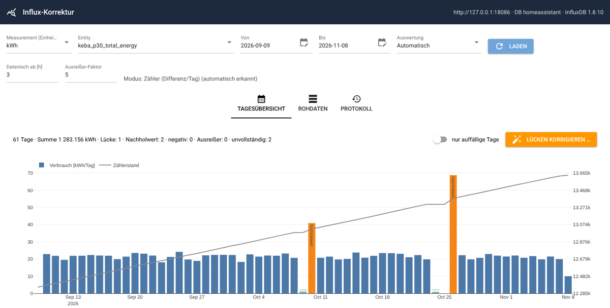
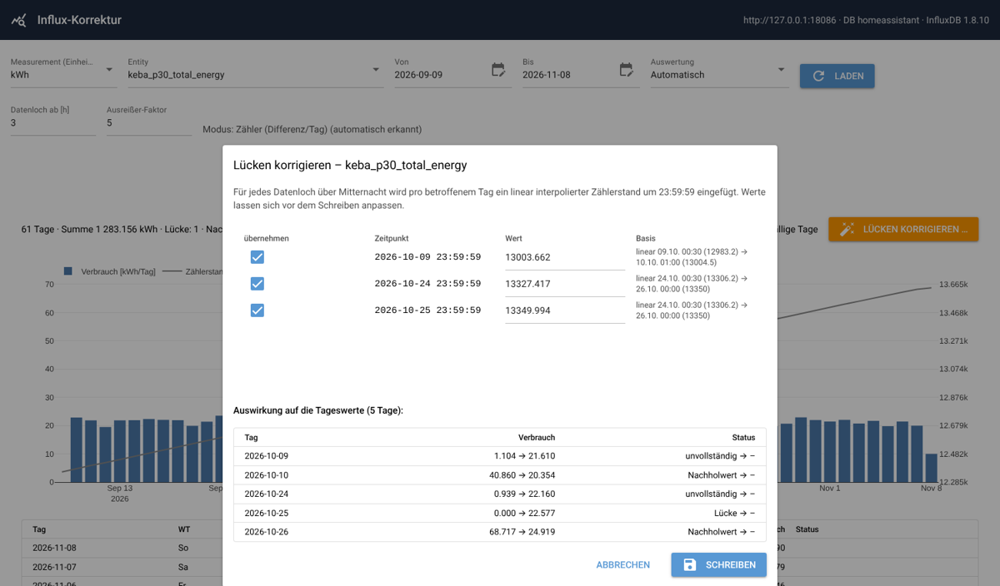
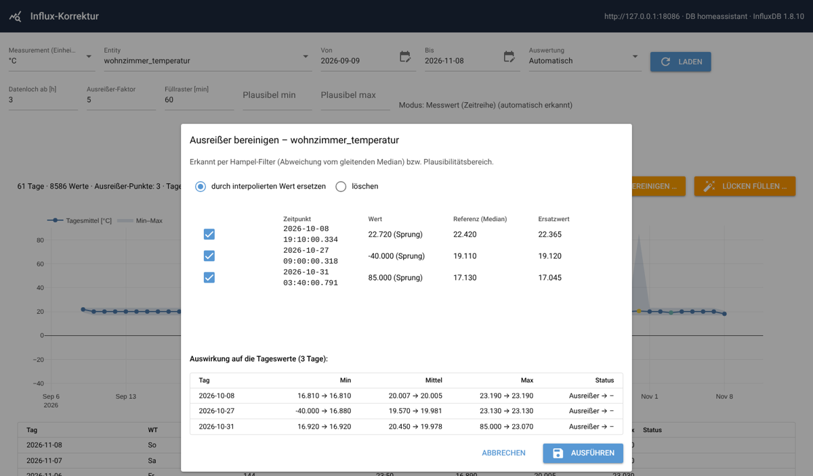
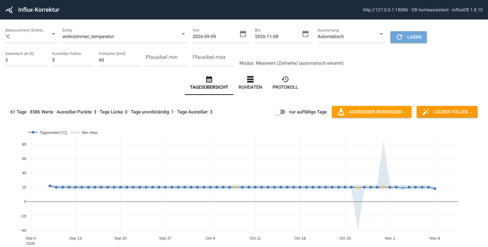
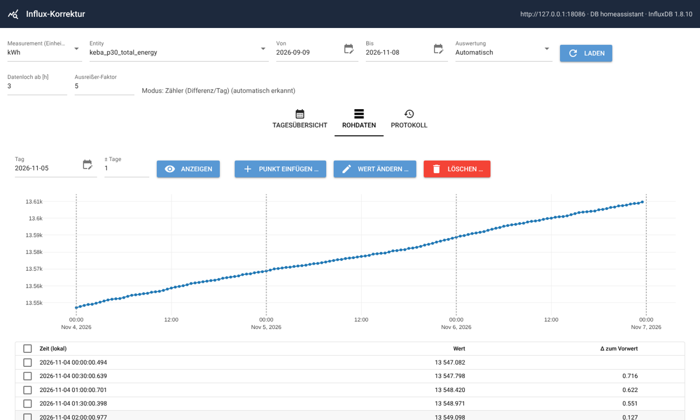

# Influx-Korrektur

**English** | [Deutsch](README.de.md)

A small web app for **inspecting and correcting time series in InfluxDB** that
[Home Assistant](https://www.home-assistant.io/) writes via its
[InfluxDB integration](https://www.home-assistant.io/integrations/influxdb/).
It runs as a self-contained Docker container (e.g. on a Synology NAS).

> **Note:** The user interface is currently in German. This README explains every UI term in English.



## Why?

Many dashboards compute daily or monthly consumption from the **absolute meter reading** (electricity, water,
gas), typically with a query like

```sql
SELECT derivative(max("value"), 1d) FROM "kWh"
WHERE "entity_id" = 'my_meter' AND time >= now() - 400d
GROUP BY time(1d) fill(previous) tz('Europe/Berlin')
```

If a sensor delivers no values for a day, that day shows **0** and the **next day gets the consumption of both
days**. The fix is to insert interpolated readings, which used to mean hand-written API calls with hand-calculated
timestamps. This tool does it with a few clicks, with a preview of the effect and a full undo.

The same applies to plain measurements (temperature, humidity, …): gaps can be filled and outliers (sensor glitches
such as `85.0` or `-40.0`) can be removed or replaced.

## Features

- **Daily overview** (*Tagesübersicht*) with chart and status badges for every day
- **Two analysis modes**, selectable per series, auto-detected by default:
  - **Counter** (*Zähler*): daily consumption = max(day) − max(previous day), identical to the query above
  - **Gauge** (*Messwert*): daily min / mean / max for ordinary time series
- **Gap correction** (*Lücken korrigieren / füllen*): linearly interpolated points, editable before writing
- **Outlier cleanup** (gauge mode): Hampel filter plus optional plausibility range; delete or replace by interpolation
- **Raw data view** (*Rohdaten*): insert, edit or delete single points, with interpolation from neighbours
- **Preview** of every change: daily values before → after
- **Audit log with undo** (*Protokoll*): the original points (all fields, exact tags) are saved before every change
- Works with **InfluxDB 1.8** (e.g. the Home Assistant add-on) and **InfluxDB 2.x** (auto-detected)

## Screenshots

| Gap correction (counter) | Outlier cleanup (gauge) |
|---|---|
|  |  |

| Gauge overview (min–max band, daily mean) | Raw data |
|---|---|
|  |  |

## Analysis modes

| | Counter (*Zähler*) | Gauge (*Messwert*) |
|---|---|---|
| Daily value | consumption = max(day) − max(previous day) | min / mean / max |
| Data gap (*Datenloch*) | two consecutive points across midnight, more than `HOLE_HOURS` apart, **and** the counter increased | any two consecutive points more than `HOLE_HOURS` apart |
| Fill gaps | one point per affected day at **23:59:59** local time | points on a regular grid (`GRID_MINUTES`) |
| Outliers | day: consumption > factor × median daily consumption | point: Hampel filter (factor × MAD around the rolling median) + optional min/max |
| Typical sensors | `total_energy`, water meter, gas meter | temperature, humidity, power, CO₂ |

*Automatic* (*Automatisch*) picks **counter** if the values (almost) never decrease, otherwise **gauge**.
Mode and parameters are stored per series in `data/settings.json`.

### Status badges

| Badge | Meaning |
|---|---|
| *Lücke* (gap) | the day lies completely inside a data gap (or after the last value) |
| *unvollständig* (incomplete) | the day contains the start of a data gap |
| *Nachholwert* (catch-up) | counter: this day receives the consumption of the gap |
| *negativ* (negative) | counter: reading decreased (reset / meter replacement?) |
| *Ausreißer* (outlier) | see table above |

Days without values on which the counter did **not** change (e.g. a wallbox not charging; Home Assistant only writes
on state changes) are intentionally **not** flagged, because no consumption is shifted.

## Installation

### Requirements

- Docker with Docker Compose (Synology: *Container Manager*)
- Network access to InfluxDB (port `8086`)
- An InfluxDB user with write access to the Home Assistant database (see [Permissions](#influxdb-permissions))

### Docker Compose

```bash
git clone https://github.com/jomjol/influx-korrektur.git
cd influx-korrektur
cp .env.example .env        # enter your InfluxDB connection
docker compose up -d --build
```

Open `http://<host>:8099`.

### Synology (Container Manager)

1. Copy or clone the repository to `/volume1/docker/influx-korrektur`.
2. Copy `.env.example` to `.env` and fill in your credentials.
3. *Container Manager → Project → Create*, choose the folder; `docker-compose.yml` is detected → build and start.
4. **Update:** stop the project, replace the files (or `git pull`), then *Action → Build*.
   Via SSH: `git pull && sudo docker compose up -d --build`

`data/` (audit log, settings) and `.env` are not touched by updates.

## Configuration

All settings are environment variables (file `.env`):

| Variable | Default | Description |
|---|---|---|
| `INFLUX_URL` | `http://localhost:8086` | InfluxDB URL |
| `INFLUX_DB` | `homeassistant` | database (1.x) / database name of the DBRP mapping (2.x) |
| `INFLUX_USER`, `INFLUX_PASSWORD` | – | credentials (1.x) |
| `INFLUX_TOKEN` | – | API token (2.x, instead of user/password) |
| `INFLUX_ORG`, `INFLUX_BUCKET` | –, `INFLUX_DB` | only needed for deleting in 2.x |
| `INFLUX_RP` | – | retention policy (optional) |
| `ENTITY_TAG` | `entity_id` | tag that identifies a series |
| `TZ` | `Europe/Berlin` | time zone for day boundaries |
| `DEFAULT_MEASUREMENT` | `kWh` | preselected measurement (Home Assistant uses the unit as measurement name) |
| `DEFAULT_DAYS` | `60` | default time range |
| `HOLE_HOURS` | `3` | data gap threshold in hours |
| `OUTLIER_FACTOR` | `5` | outlier factor (meaning depends on mode, see above) |
| `GRID_MINUTES` | `60` | gauge mode: grid for gap filling |
| `MARK_FIELD` | `korrektur_str` | field added to manually written points (`manuell` / `geändert`); empty = off |
| `DATA_DIR` | `/data` | location of `audit.jsonl` and `settings.json` |
| `PORT` | `8080` | port inside the container |

## InfluxDB permissions

- **InfluxDB 1.8 (Home Assistant add-on):** the user needs `ALL` privileges on the database. If deleting fails
  with a permission error, use an admin user. Users are managed in the add-on UI
  (*Chronograf → InfluxDB Admin → Users*).
- **InfluxDB 2.x:** reading and writing use the v1 compatibility API, so a
  [DBRP mapping](https://docs.influxdata.com/influxdb/v2/query-data/influxql/dbrp/) for the bucket is required.
  Deleting uses `/api/v2/delete` (`INFLUX_ORG` and `INFLUX_BUCKET` required). The token needs read/write access to
  the bucket.

## How it works

- **Exact timestamps:** points are read and written with nanosecond precision, so edits and deletes hit the original
  Home Assistant point exactly.
- **Same series:** new points copy the complete tag set (`domain`, `entity_id`, …) of the nearest existing point. The
  marker `korrektur_str` is a *field*, not a tag, so no new series is created.
- **Editing** overwrites the `value` field of the existing point; other fields (e.g. `friendly_name_str`) remain.
- **Deleting** in InfluxDB always removes *all* fields at that timestamp, including Home Assistant attributes. Undo
  restores them from the audit log.
- **Audit log:** every action is appended to `data/audit.jsonl` with the complete original points. Every entry
  can be undone from the *Protokoll* tab.
- **Day boundaries** are computed in the configured time zone and are DST-safe (23 h / 25 h days).

## Limitations

- **Back up your database** before larger corrections. The audit log covers every change made by this tool, but it
  is not a substitute for a backup.
- Interpolation is an **estimate**: consumption during a gap is spread linearly over time.
- Gaps at the very end of the range (sensor still offline) cannot be corrected until a new value arrives.
- Only the field `value` is analysed (Home Assistant's default).
- No user management. Run it in your LAN or behind a VPN/reverse proxy with authentication; **do not expose it to
  the internet.**
- UI language is German only.

## Development

```bash
pip install -r requirements.txt pytest
pytest tests                                  # unit tests + end-to-end against an InfluxDB 1.8 simulator

# run locally against the simulator (with test data incl. gaps and outliers)
python tests/fake_influx.py 18086 &
cd app && INFLUX_URL=http://127.0.0.1:18086 DATA_DIR=/tmp/data python main.py
```

### Project structure

```
app/
  main.py        web UI (NiceGUI)
  analysis.py    daily values, gap/outlier detection, interpolation (pure functions, tested)
  influx.py      InfluxDB access (1.x / 2.x), line protocol
  ops.py         insert / edit / delete with audit log and undo
  settings.py    per-series settings
tests/
  fake_influx.py minimal InfluxDB 1.8 HTTP simulator
  seed.py        test data
  test_core.py   tests
```

Tech stack: Python 3.13, [NiceGUI](https://nicegui.io/), pandas, Plotly.

## Contributing

Issues and pull requests are welcome. Please run `pytest tests` before submitting and describe the InfluxDB version
and the kind of sensor you tested with.

## License

[MIT](LICENSE) © 2026 jomjol
